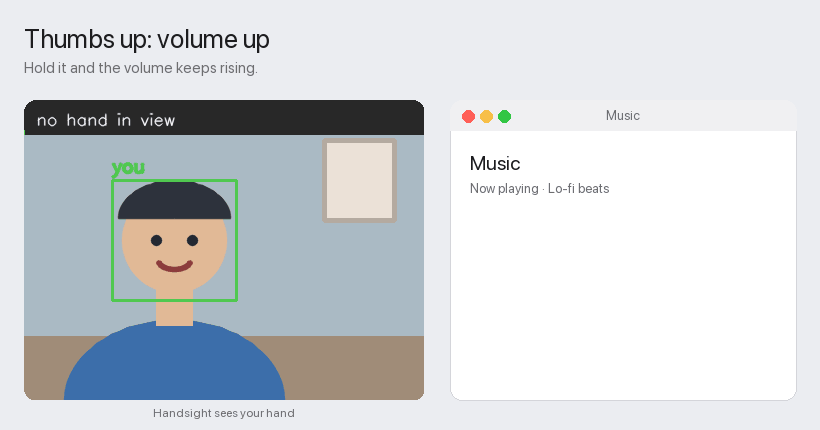
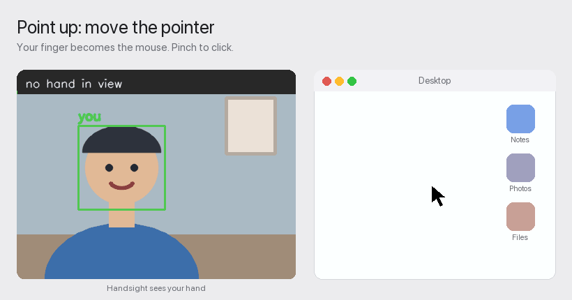
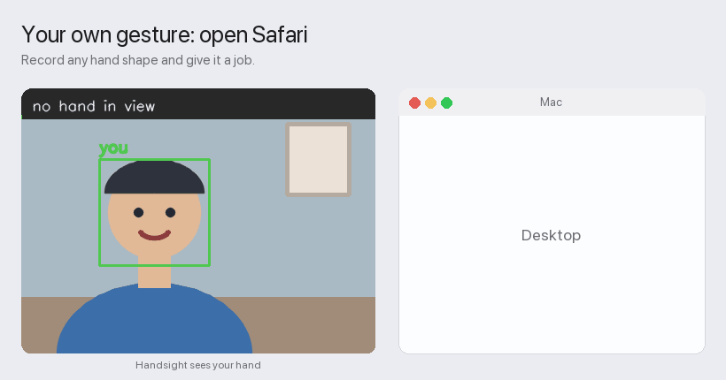
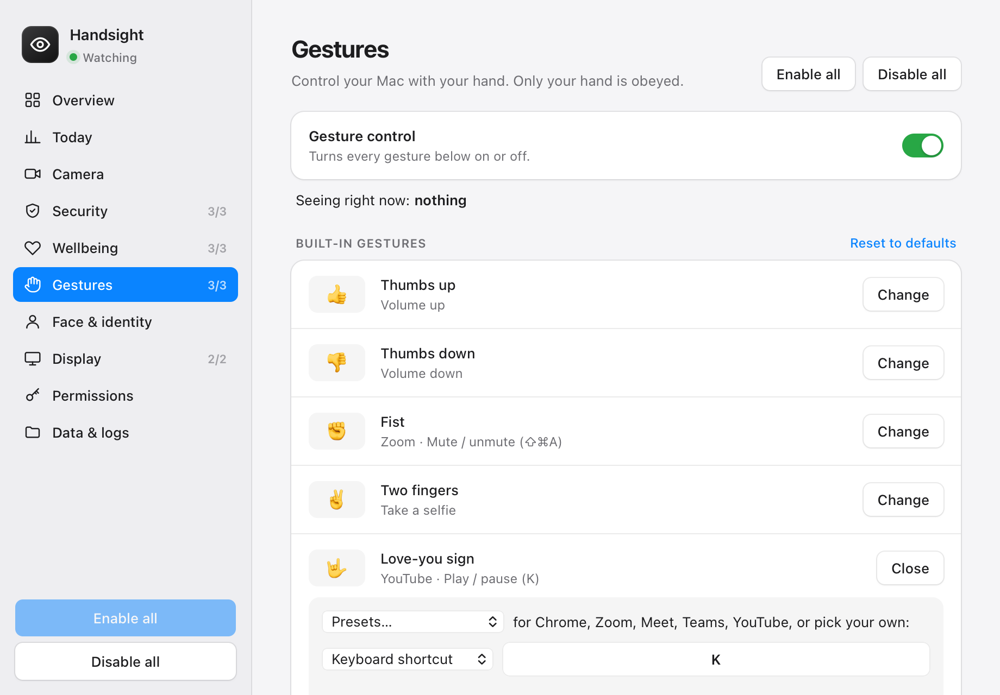
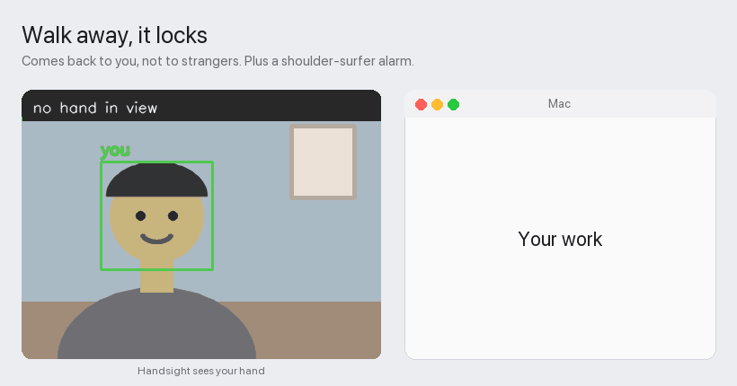
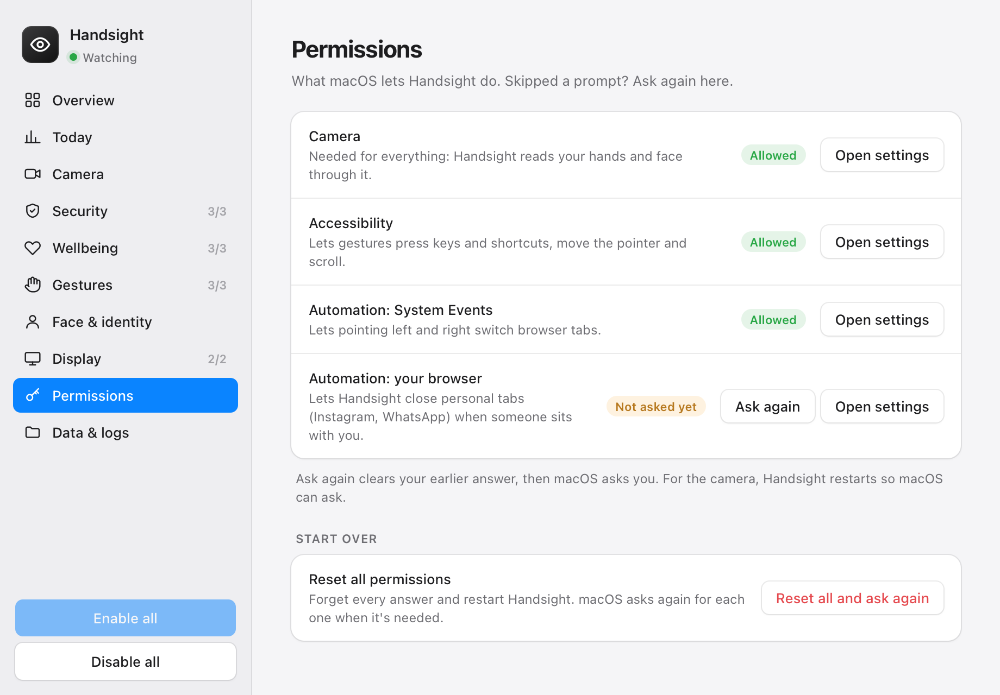

# Handsight

**Control your Mac with your hands, through your webcam.** Thumbs up for volume, point to
switch Chrome tabs, a fist to mute your Zoom call, your finger as the mouse pointer. Record
any hand shape you like and give it a job: a keyboard shortcut, an app, a website or an
Apple Shortcut. Everything runs on your Mac; no video ever leaves it.

Handsight started as a hands-free tool for people who can't always reach the keyboard or
trackpad: a cast on your wrist, RSI, a standing desk, cooking with messy hands, presenting
from across the room. It also watches your back: it locks the Mac when you walk away and
warns you when someone reads over your shoulder.

<p align="center">
  
</p>

<p align="center">
  <a href="https://github.com/Abhi183/handsight/releases/latest"></a>
  <br>
  <sub>macOS 13 or newer · Apple Silicon (M1 and later) · signed and notarized by Apple · free and open source</sub>
</p>

## What you can do

- **Control your Mac hands-free.** Volume, mute, play and pause, next track, browser tabs,
  scrolling and the mouse pointer, all with hand gestures.
- **Run your meetings.** Ready-made actions mute and unmute, turn the camera on and off and
  raise your hand in **Zoom, Google Meet and Microsoft Teams**.
- **Drive Chrome and YouTube.** New tab, close tab, back, forward, reload, find, full screen,
  YouTube's play and skip keys.
- **Make your own gestures.** Record any hand shape in 2 seconds and attach a shortcut, an
  app, a website, an Apple Shortcut or (if you switch it on) a Terminal command.
- **Only you are obeyed.** Handsight learns your face, and only the hand nearest to you counts.
  Someone waving behind you does nothing.
- **Guard your screen.** It locks the Mac when you leave, alarms when someone looks over your
  shoulder, and can close Messages and WhatsApp when someone sits down next to you.

## Gestures

| Gesture | Out of the box |
|---|---|
| 👍 Thumbs up / 👎 down (hold) | Volume up / down, with the normal macOS volume pop-up |
| ✊ Fist (hold 0.8 s) | Mute |
| 👉 Point right / 👈 left | Next / previous browser tab |
| 🖐️ Open palm, then move up or down | Scroll, like two fingers on a trackpad |
| ☝️ Point up | Take the mouse pointer: move your hand to move it, pinch to click |
| ✌️ Two fingers | Webcam selfie |
| 🤟 Love-you sign | Play / pause music and video |

Every one-off gesture can be changed in **Settings > Gestures**, and you can add your own.

<p align="center">
  
  
</p>

## Make it yours

Click **Change** next to any gesture and pick what it does. The **Presets** menu has
ready-made actions:

| App | Ready-made actions |
|---|---|
| Zoom | Mute ⇧⌘A, camera ⇧⌘V, raise hand ⌥Y, share screen ⇧⌘S |
| Google Meet | Mute ⌘D, camera ⌘E, raise hand ⌃⌘H |
| Microsoft Teams | Mute ⇧⌘M, camera ⇧⌘O, raise hand ⇧⌘K |
| Chrome | Next / previous tab, new tab, close tab, reopen tab, reload, back, forward, find, full screen |
| YouTube | Play / pause (K), back / forward 10 s (J / L), full screen (F) |
| Music and video | Play / pause, next track, previous track |

Or press any keyboard shortcut, open an app or website, or run one of your Apple Shortcuts.
Shortcuts go to the app in front, so click into your meeting window first.

**Record a new gesture** to add any hand shape, up to 20. Hold it still for 2 seconds while
Handsight learns it, then name it and pick an action. It works with either hand, and
"Seeing right now" shows what Handsight thinks your hand is doing.

<picture>
  <source media="(prefers-color-scheme: dark)" srcset="docs/demo/settings-gestures-dark.png">
  
</picture>

## Guard your screen

<p align="center">
  
</p>

- **Auto-lock:** you leave your desk for 2 seconds (you can pick 2 to 30), the Mac locks.
  Looking away or putting your head down doesn't count as leaving.
- **Shoulder-surfer alarm:** a second face looking at your screen gets a red pop-up, a sound
  and a photo in `caught/`.
- **Company:** someone sits next to you for 8 seconds, Messages and WhatsApp quit and
  Instagram and WhatsApp tabs close.
- **Posture and water:** gentle nudges when you slouch or haven't had a glass in a while.

## Privacy

Handsight runs entirely on your Mac. Video is processed frame by frame in memory and never
saved or sent anywhere; there is no account, no analytics and no network access apart from
what your own gesture actions do. Your face profile is a list of numbers (no photo), and
recorded gestures are hand-landmark numbers. Both stay in
`~/Library/Application Support/Handsight`.

## Install

1. [Download the latest Handsight .dmg](https://github.com/Abhi183/handsight/releases/latest),
   open it and drag Handsight into Applications.
2. Open Handsight and allow the camera.
3. When macOS says Handsight would like to control this computer, click Open System
   Settings and switch Handsight on. Gestures need it to press keys and move the pointer.

Skipped a prompt or clicked Don't Allow? **Settings > Permissions** shows what's allowed
and has an **Ask again** button for each permission.

<picture>
  <source media="(prefers-color-scheme: dark)" srcset="docs/demo/settings-permissions-dark.png">
  
</picture>

Coming from Desk Guard (the old name)? Handsight takes over your face profile, gestures and
settings on first launch. You'll be asked for permissions once more because it's a new app
to macOS; you can delete Desk Guard afterwards.

## How it works

| Feature | Behaviour |
|---|---|
| Someone behind you | A second face in view for about half a second: red pop-up, sound, photo saved to `caught/` |
| Auto-lock | You not at the desk for 2 seconds (`--lock-after N`): the Mac locks. "At the desk" means your face, or your body still in your spot. See "Auto-lock" below. It re-arms when you come back |
| Posture | Learns how you sit in the first couple of seconds. Leaning in or slouching for 5 seconds gives a pop-up, at most once a minute |
| Gestures | See [Gestures](#gestures) above |
| Knows your face | The first time it sees you with nobody sitting next to you it learns your face (about 3 seconds). After that your box says "you" (or your name, see below) and everyone else is "WHO'S THIS?" |
| Only your gestures | A hand counts only if it is nearer your face than anyone else's. Other people's hands show "not your hand, ignored". If you are not in the frame, nobody can gesture |
| Company | Someone sitting next to you for 8 seconds (`--company-after N`): Messages, WhatsApp and Instagram quit, and their tabs close in Chrome, Brave and Safari |

Alerts are drawn by the app itself in the top-right corner, because macOS often hides banners
from scripts.

### Holding a gesture

A gesture fires when the green bar under the banner fills (0.4 s by default; change it under
Gestures > Hold time). Mute needs a longer hold because a relaxed or lowered hand often looks
like a fist. Right after you let go of the pointer, gestures pause for a moment so lowering
your hand doesn't trigger anything. Setting a gesture to "Nothing" switches it off; it then
shows "switched off in settings" in the status strip instead of firing.

### Your own gestures

Settings > Gestures lists every hand shape with what it does. Click Change to pick another
action:

- a built-in action: volume up / down, mute, play / pause, next / previous track, selfie,
  next / previous tab, lock the screen
- a keyboard shortcut: click the box and press the keys, for example ⌘⇧4 or just `K`
  (YouTube's play / pause key)
- open an app (Choose app…), a website or a file
- run one of your Apple Shortcuts, which can chain any number of steps
- a Terminal command, only after you switch on "Allow Terminal commands" (it runs in zsh as
  you, for up to 30 seconds; its output goes to the activity log)
- nothing

Test runs the action once. Volume up and down repeat while you hold the gesture; everything
else fires once per hold.

Record a new gesture lets you add any hand shape (up to 20). Handsight counts down from 3,
then you hold the shape still for 2 seconds while it records about 60 snapshots of your hand.
Name it, pick an action, save. It works with either hand. Recorded shapes are checked first,
so one that looks like a built-in gesture takes over that shape, and one that MediaPipe calls
"pointing up" won't grab the pointer. Handsight warns you when a new shape looks like a
built-in one or like another of yours. "Seeing right now" on the same page shows what
Handsight thinks your hand is doing, which helps when a shape doesn't fire.

Everything is saved in `gestures.json` next to the settings: the actions, and for recorded
shapes the hand-landmark numbers (no photos). Reset to defaults puts the built-in gestures
back as they were.

### Moving the pointer

Point your index finger up for a third of a second and your hand takes the mouse pointer. It
works like a trackpad: the pointer starts where it is and follows how your hand moves, across
all displays. Slow movement is fine control, a quick sweep goes much further. While you hold
it:

- pinch thumb and index finger together: click (there is no right click)
- fist: lift the mouse. The pointer stays put while you move your hand back to a comfortable
  spot; point again to carry on
- open your palm: switch straight to scrolling; point up again to get the pointer back
- any other gesture held for half a second (two fingers, thumbs up...): let go of the
  pointer, and that gesture works as usual
- lower your hand out of view: let go

The pointer stands still during a pinch, and freezes the moment another gesture appears,
so it never drifts while you change hands. There is no drag or double-click.
Turn it off under Settings > Gestures > Move the pointer, or `--no-cursor`.

### Auto-lock

The lock goes by whether you are physically at the desk, so looking away or putting your
head down does not lock the Mac. Your face has to be recognised once. From then on you
count as present while something of you stays in your spot without a break: a face there,
even turned so far that it no longer matches, or your body (a person-segmentation model
checks the area under where your head was). When the spot has been empty for 1.5 seconds
that chain ends, and only your recognised face starts a new one. So an empty chair locks,
and so does a stranger who sits down after you left.

When your face is hidden the video window shows the body reading, for example
`face hidden, body in your spot: 62% (needs 35%)`.

### Your face

The profile is a gallery of up to 40 samples (128 numbers each) in `face_profile.npy`,
readable only by you and ignored by git. No photo is kept. The first sample comes from the
initial learning. After that the app adds a sample whenever it sees you looking different
enough from what it has (a side view, new light, a photo of you on a phone), so recognition
gets better the longer it runs. A face counts as you at 0.5 similarity to any sample. On 93
test faces, every view of the owner that matched scored 0.51 or more and the closest
stranger scored 0.42.

`./run train` adds samples from photos you already have: the selfies in `snaps/` and your
own face in `caught/`, or any folders you pass it. Faces that don't already look like you
are skipped.

A photo of you counts as you: hold one up and its box gets your name too. If the app learned the wrong face, or recognition gets worse after a haircut or
new glasses, press `f` in the video window or pick "Relearn my face" in the menu, then look at
the camera on your own.

To see your name on the box, set it under Settings > Face & identity (or pass `--name Alex`
to `./run desk`). Plain letters only, 20 characters at most.

### Company

"Sitting with you" means a second face at least a quarter the height of the nearest one, for
8 seconds. That covers someone on a chair just behind you. People at desks across the room
are smaller than that, and people walking past don't stay long enough. Apps are asked to
quit the same way Cmd+Q does. It runs once per visit: if you reopen Messages while they are
still there, it stays open until they leave and someone sits down again. The apps and sites
are listed at the top of `handsight/personal.py`.

## The app

Handsight.app is one process with its own Dock icon, menu bar, video window and settings
window. Its executable (`tools/launcher.c`) runs Python inside itself, so macOS sees a real
app called Handsight rather than "Python". The watcher runs on background threads; one
thread keeps only the newest camera frame so the video never falls behind, and hand
recognition runs alongside face detection.

Settings apply instantly, with nothing restarted, and are saved to `menubar_settings.json`.

**Settings window**: Cmd-, , the gear in the video window's title bar, `s` in the video
window, clicking the Dock icon, or Settings... in the eye menu.

- Overview: status with start/stop, Enable all / Disable all features, a switch for each
- Camera: Automatic (a plugged-in webcam, else the built-in camera; an iPhone used as a
  Continuity Camera only as a last resort) or a specific camera. Cameras are opened by
  their macOS device ID, so you get exactly the one you pick, and a switch takes under a
  second. If your pick is unplugged Handsight uses another camera and switches back within
  about 2 s of it returning. After a switch, posture and the auto-lock start fresh.
- Security: auto-lock with lock delay (2/5/10/30 s), shoulder-surfer alarm, close personal
  apps with company
- Today: time at the desk, good-posture share, glasses of water, breaks (5+ min away),
  a 7-day chart, and counts of nudges, alerts, locks, gestures and scrolls. Kept for 30
  days in `stats.json` (gitignored, never leaves the Mac)
- Wellbeing: posture alerts, drink water reminders (every 30/45/60/90 min of desk time;
  click the reminder or "Log a glass" to count one), sounds, recalibrate posture
- Gestures: master switch, what each gesture does, record your own, live "seeing right now",
  scrolling and pointer switches, hold time (fast 0.25 s, normal 0.4 s, careful 0.7 s),
  allow Terminal commands
- Face & identity: your name, relearn my face
- Display: video window on/off, keep it on top
- Data & logs: caught photos, selfies, activity log

**Video window**: Cmd-1 shows or hides it, and so does the red close button; closing it
never stops watching. The pin in the title bar floats it above other windows, on every Space
and over full-screen apps. Keys: `s` settings, `m` mute, `c` recalibrate posture,
`l` auto-lock on/off, `g` gestures on/off, `f` relearn my face.

**Eye menu** in the menu bar: status, start/stop, show video window, Enable all / Disable all
features, settings, quit. Cmd-Q quits from anywhere in the app.

## Permissions

- **Camera**: Handsight asks the first time it starts. It is granted per app, so Terminal
  (for `./run desk`) and Handsight.app each need it. Rebuilding the app with
  `tools/make_app.sh` gives it a new signature, so macOS asks again.
- **Accessibility**: needed for tab switching, moving the pointer and the volume pop-up (the app presses the real
  keys). Add Handsight under System Settings > Privacy & Security > Accessibility.
- **Automation**: the first time a visitor triggers tab closing, macOS asks whether Handsight may
  control Chrome (or Brave, Safari). Say yes, or tabs stay open. Quitting apps needs nothing.
- **Menu bar icon missing**: macOS 26 hides new menu bar items. Turn on **Handsight** under
  System Settings > Menu Bar > Allow in the Menu Bar.

## Known limits

- Auto-lock follows whoever stays in your spot. Someone who slides into your chair within
  1.5 seconds of you leaving it is taken for you until they leave. Until your face has been
  learned, any face keeps it unlocked.
- Hands are matched to faces by distance in the picture. Someone who reaches across in front
  of you can still trigger a gesture.
- Firefox has no AppleScript support for tabs, so Instagram or WhatsApp tabs there stay open.
- Face recognition is for convenience. A photo of you would pass, so don't treat it as a lock.
- Locking uses `SACLockScreenImmediate` from the private `login.framework`; if Apple removes it,
  the app falls back to sleeping the display.

## For developers

### Run from source

You need [uv](https://docs.astral.sh/uv/) and the Xcode command line tools (for `clang`).

```
git clone https://github.com/Abhi183/handsight.git
cd handsight
./run desk
```

The first `./run` creates `.venv` with uv's native Python 3.12 (an Intel Python under
Rosetta runs the models about half as fast), installs `requirements.txt` and downloads the
face recognition model (37 MB). Then:

```
tools/make_app.sh      # builds Handsight.app on your Desktop (or pass a folder)
./run app              # opens it (builds it first if it is missing)
```

### Build the .dmg

```
tools/build_dmg.sh 1.0      # version number
```

This makes `dist/build/Handsight.app` and `dist/Handsight 1.0.dmg` (about 200 MB). The app
carries its own Python 3.12, the libraries and the models, so it runs on any Apple Silicon
Mac. It leaves out the parts of mediapipe Handsight never uses (jax, jaxlib,
sentencepiece, sounddevice), which saves about 350 MB. Run `./run desk` once first so the
models are downloaded.

Signing is picked automatically:

- With a **Developer ID Application** certificate in your keychain, the app is signed with the
  hardened runtime (`tools/entitlements.plist`). If the notary profile exists it is also
  notarized and stapled, the app first and then the .dmg, so it opens on any Mac with no
  warning. Create the profile once:
  `xcrun notarytool store-credentials deskguard --apple-id <apple id> --team-id <team id>`
  (it asks for an app-specific password from account.apple.com).
- Without one it is ad-hoc signed, and other Macs need System Settings > Privacy &
  Security > Open Anyway the first time.

`SIGN_IDENTITY="<name or hash>"` picks a certificate (`-` for ad-hoc), `NOTARY_PROFILE`
names a different profile and `NOTARIZE=0` skips notarizing.

The downloadable app and the one from `tools/make_app.sh` share a bundle ID, so run only one
of them at a time. They keep separate data: the source checkout stores its files in the
project folder.

### Other toys

```
./run gestures    # gestures only, in their own window
./run ascii       # webcam as live ASCII art in the terminal (--style matrix|color|mono)
```

### Demo assets

`tools/make_demo.py` draws the GIFs in `docs/demo` from illustrated scenes (a cartoon person,
drawn hand poses) run through the real gesture code. `tools/snap_settings.py` screenshots
the settings window with sample data.

### Layout

- `handsight/menubar.py` the app: menus, windows, camera permission, Dock
- `handsight/engine.py` watcher threads: newest-frame camera reader, DeskApp loop
- `handsight/avcamera.py` captures from AVFoundation by camera ID and swaps cameras in place
- `handsight/cameras.py` lists cameras and picks the one to use (unit tested)
- `handsight/desk.py` DeskApp (faces, lock, posture, gestures) and the Terminal version
  with an OpenCV window (`./run desk`)
- `handsight/video_window.py`, `settings_panel.py`, `native_toast.py` AppKit windows
- `handsight/settings_ui.html`, `settings_api.py` settings page and what it may call (tested)
- `handsight/settings.py` saved options and the `desk.py` flags they turn into (unit tested)
- `handsight/gestures.py`, `pointing.py`, `gesture_trigger.py` gesture recognition and actions
- `handsight/gesture_actions.py`, `gesture_store.py`, `gesture_runner.py` what each gesture
  does, saved in `gestures.json`, and starting programs (unit tested)
- `handsight/custom_gestures.py` recording and matching your own hand shapes (unit tested)
- `handsight/gesture_api.py`, `settings_gestures.js` the Gestures settings page
- `handsight/cursor.py` pointer control logic (unit tested)
- `handsight/presence.py`, `watch.py`, `posture.py`, `identity.py` decision logic (unit tested)
- `handsight/body.py` person segmentation, for auto-lock when your face is hidden
- `handsight/recognition.py` face profile: learn, save, match, grow
- `handsight/train_face.py` adds profile samples from saved photos (`./run train`)
- `handsight/personal.py` quits personal apps and closes their browser tabs
- `handsight/macos.py`, `dock.py`, `toast.py` macOS glue: lock, keys, pop-ups, Dock icon
- `handsight/paths.py` where the code lives and where your files go (project folder, or
  Application Support in the downloadable app)
- `tools/make_app.sh` builds the `.app` around `tools/launcher.c` for this checkout;
  `tools/build_dmg.sh` builds the self-contained app and .dmg; `tools/make_icon.py` draws the icon
- `models/` YuNet face detector and SFace face recognizer (opencv_zoo), MediaPipe
  `gesture_recognizer.task` and `selfie_segmenter.tflite`

### Tests

```
.venv/bin/python -m pytest -q
```

## Credits

Handsight is made by [Abhishek Shekhar](https://github.com/Abhi183). If it helps you, a star
on this repo helps other people find it. Using it in research or writing about it? The
"Cite this repository" button on GitHub gives you a ready-made citation.

It stands on [MediaPipe](https://github.com/google-ai-edge/mediapipe) for hand tracking and
[OpenCV](https://opencv.org) with the YuNet and SFace models from
[opencv_zoo](https://github.com/opencv/opencv_zoo) for faces.

## License

Handsight is free and open source under the [Apache License 2.0](LICENSE). You can use,
change and share it, including in commercial projects. If you redistribute it or something
built from it, keep the copyright notice and the [NOTICE](NOTICE) file with it, which credits
the original author.
